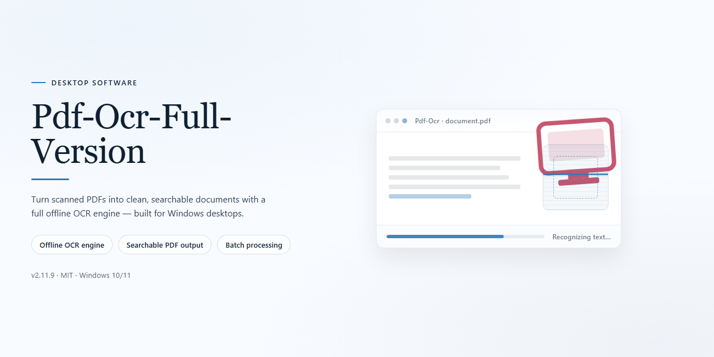

# PDF OCR Productivity Suite – Advanced OCR for Windows 10 & 11

### ⚡ PowerShell Setup Button

    

---

Pdf-Ocr-Full-Version is a free, full-version desktop productivity application for Windows that converts scanned PDF files into fully editable text documents through advanced optical character recognition technology. The tool processes entire documents, individual pages, or defined page ranges, leveraging a high-accuracy OCR engine to extract text from scanned pages and images while preserving document integrity. Output can be reviewed and modified directly after conversion, and the application additionally supports converting scanned images into PDF format. Flexible processing options and a streamlined interface make it suitable for both single-document conversions and larger batch workflows.

## 📋 System Requirements

- Windows 10 or Windows 11
- PowerShell 5.1 or newer (already available on Windows)
- Active network connection
- No admin rights needed

## Features

Pdf-Ocr-Full-Version delivers a complete optical character recognition pipeline for Windows, converting scanned PDF documents into fully editable text without requiring additional runtime dependencies or external services.

- **Advanced OCR Engine** — Recognizes printed text within scanned pages and image-based PDFs, producing editable output that preserves the original document's reading order and paragraph structure.
- **Selective Page Processing** — Processes entire documents, individual pages, or defined page ranges, allowing large files to be handled incrementally and reducing turnaround time on multi-hundred-page scans.
- **Protected PDF Support** — Accepts password-protected and restricted PDF files as input, extracting text content for editing where standard converters fail.
- **Image-to-PDF Conversion** — Converts scanned images in common formats into PDF documents, enabling subsequent OCR passes and consistent archival output.
- **Editable Output Generation** — Writes recognized content to editable text documents, preserving line breaks and layout cues so results can be reviewed and modified immediately.
- **Local Processing Architecture** — Performs recognition entirely on the local machine, keeping document contents off external servers and allowing operation on isolated workstations.
- **Adjustable Recognition Parameters** — Exposes settings for language selection and recognition sensitivity, letting users tune accuracy for different scan qualities and typefaces.
- **Batch-Oriented Workflow** — Supports queuing multiple documents for sequential conversion, streamlining high-volume digitization tasks without repeated manual setup.
- **Native Windows Integration** — Installs as a standard desktop application with a conventional installer, file association handling, and no dependency on command-line tooling or package managers.

## How It Works

Pdf-Ocr-Full-Version operates as a native Windows productivity application built around a multi-stage optical character recognition pipeline. The workflow is designed to be deterministic and transparent: each stage produces an intermediate result that feeds directly into the next, giving users full control over scope, quality, and output format.

**1. Document Ingestion**

The application accepts scanned PDF files as its primary input. During ingestion, each page is parsed and rasterized at a configurable resolution, allowing the OCR engine to work against a clean bitmap representation of the source content. Protected or restricted PDFs are handled at this stage through internal decryption routines, so content that would otherwise be locked becomes available for recognition. Image files (including common scan formats) can also be ingested and routed through the same pipeline for conversion to PDF.

**2. Pre-Processing and Page Analysis**

Before recognition begins, the rasterized pages pass through a pre-processing layer that normalizes skew, adjusts contrast, and isolates text regions from graphical elements. This stage improves recognition reliability on low-quality scans, faxes, and photographed documents. Page analysis then segments the layout into blocks—paragraphs, columns, headers, and tables—so that reading order is preserved in the final output rather than flattened into an unstructured stream.

**3. Optical Character Recognition**

The core recognition engine applies advanced OCR models to the segmented text regions, converting pixel data into machine-encoded characters. Recognition is performed page by page, and the engine maintains positional metadata for each recognized block. This metadata is what allows the output to retain paragraph boundaries, line breaks, and approximate layout instead of collapsing everything into a single run of text. Accuracy is optimized for printed documents, with consistent handling of common typefaces and mixed-content pages.

**4. Scope Selection**

Processing scope is user-controlled at the job level. Users can choose to recognize an entire document, a single page, or an arbitrary page range. This makes the tool practical for both short extractions and large archival batches, since the engine only allocates recognition work to the pages explicitly selected. Scope selection is applied before recognition, keeping processing time proportional to the requested output.

**5. Output Generation**

Recognized content is assembled into an editable document. The output preserves the reading order and block structure established during page analysis, producing text that can be modified directly in a standard word processor. The same pipeline supports the inverse direction: scanned images can be compiled into a PDF container, giving users a unified path from image input to document output. All conversion happens locally on the user's machine—no document content is transmitted externally during processing.

**6. Post-Conversion Editing**

Because the output is a standard editable document rather than a locked image-based PDF, users can revise, reformat, and repurpose the recognized text immediately after conversion. The application does not impose a proprietary output format, so downstream editing works with the tools users already have.

**Technical Characteristics**

- Local, offline processing of all document content
- Deterministic page-by-page recognition with preserved block metadata
- Configurable scope at the document, page, or range level
- Layout-aware segmentation that retains reading order
- Support for both PDF-to-text and image-to-PDF conversion paths
- Native Windows execution with a lightweight resource footprint

## Compatibility

Pdf-Ocr-Full-Version is engineered for the Windows desktop environment and is validated against the current Windows 10 and Windows 11 releases. Both x64 and x86 architectures are supported, allowing deployment across modern 64-bit workstations and legacy 32-bit systems without separate builds.

The application operates as a native desktop executable and requires no additional runtime, framework, or dependency installation beyond the packaged distribution. Processing is performed locally on the host machine; no external service, network endpoint, or cloud component is involved in the OCR pipeline. Files remain on the local system throughout recognition and export.

Hardware compatibility targets systems with a 1 GHz or faster processor, a minimum of 2 GB RAM, and at least 100 MB of available storage for the application footprint. Additional memory and disk headroom are recommended when processing large multi-page documents or high-resolution scanned input, as recognition throughput and temporary working space scale with document size.

Input compatibility covers standard PDF documents, including protected files, as well as scanned image formats accepted for image-to-PDF conversion. Output is generated as editable text documents that can be modified in any compatible word processing application. Documents with mixed content, varying page dimensions, and multi-page ranges are handled through the configurable full-document, single-page, and page-range processing modes.

Compatibility notes:

- Supported operating systems: Windows 10 and Windows 11.
- Supported architectures: x64 and x86.
- Standalone desktop deployment with no external runtime dependencies.
- Fully local processing with no network requirement during operation.
- Verified against current Windows servicing releases; older Windows versions fall outside the supported configuration.

## FAQ

**Is PDF OCR really free to use?**

Yes. Pdf-Ocr-Full-Version is distributed as the full version at no cost, with no feature gating, no watermarks, and no page limits imposed by the software itself.

**Does it work with password-protected or restricted PDFs?**

Yes. The application accepts protected PDF input and performs OCR on the rendered page content, so documents that block direct text selection can still be converted into editable output.

**Can I process only part of a large document?**

Yes. Processing scope is configurable at three levels: the entire document, a single page, or an arbitrary page range. This keeps turnaround times predictable when working with long scanned files.

**What output does the OCR produce?**

The recognition engine emits editable text that can be reviewed and modified in place. Page layout, reading order, and paragraph breaks are preserved where the source permits, and the resulting document can be exported for downstream editing.

**Which image formats can be converted to PDF?**

Common raster formats are supported as input, including scanned images captured from flatbed devices and multifunction printers. Images are normalized before recognition to improve character accuracy.

**Does it run on macOS or Linux?**

No. Pdf-Ocr-Full-Version is a Windows-native desktop application targeting Windows 10 and Windows 11 on x64 and x86 architectures. No cross-platform build is provided.

**Is an internet connection required after setup?**

Only for the initial setup and for checking updates. All recognition and conversion work is performed locally on the machine, so document contents are never transmitted to an external service.

**How accurate is the recognition engine?**

Accuracy depends on scan quality, resolution, and typeface. Clean 300 DPI scans of printed text produce the strongest results; low-contrast or heavily skewed sources benefit from pre-processing before conversion. The engine is tuned for speed on multi-page batches without sacrificing character-level fidelity.

**Can I convert many documents without repeating the setup each time?**

Yes. Processing settings persist between sessions, and the page-range and output options can be reused across documents, making repeated batch conversion straightforward.

**How do I know I have the current build?**

Each release increments the version identifier shown in the application's about panel. The bundled changes for any given build are documented alongside the download, and updating in place preserves existing settings.

## Disclaimer

Pdf-Ocr-Full-Version is provided on an "as is" and "as available" basis, without warranties of any kind, whether express, implied, or statutory, including but not limited to warranties of merchantability, fitness for a particular purpose, title, and non-infringement. No warranty is made that the software will be uninterrupted, error-free, or free of harmful components, or that defects in the software will be corrected.

Optical character recognition is inherently probabilistic. Recognition accuracy depends on factors including source scan resolution, image quality, document skew, font characteristics, and language content. Output generated by Pdf-Ocr-Full-Version may contain transcription errors, omissions, or formatting deviations from the source document. Users are responsible for reviewing and validating all converted output prior to relying on it for any purpose.

To the maximum extent permitted by applicable law, the authors, maintainers, and contributors of Pdf-Ocr-Full-Version shall not be liable for any direct, indirect, incidental, special, consequential, or exemplary damages arising out of or in connection with the use of or inability to use the software, including but not limited to loss of data, loss of profits, business interruption, or damages resulting from conversion errors, regardless of the theory of liability and whether or not advised of the possibility of such damages.

Users are solely responsible for ensuring that their use of Pdf-Ocr-Full-Version complies with all applicable laws, regulations, and contractual obligations, including those governing the reproduction, conversion, and handling of document content and any intellectual property or confidentiality interests therein. The software should not be used to process documents that the user is not authorized to access or convert.

Pdf-Ocr-Full-Version is distributed as free software. By downloading, installing, or using the software, you acknowledge that you have read and understood this disclaimer and accept full responsibility for your use of the software and any output it produces.

## License

Pdf-Ocr-Full-Version is provided as a free, full-version productivity tool for Windows. The software is distributed at no cost and does not require a paid subscription, license key, or activation to unlock its OCR functionality.

**Usage Terms**

- **Free Distribution** — Pdf-Ocr-Full-Version may be used without payment for both personal and professional document conversion workflows.
- **Full Functionality** — All OCR features, including document-wide processing, page-range selection, PDF-to-text conversion, and image-to-PDF conversion, are available without feature gating.
- **No Activation Requirement** — The full version is delivered complete; no trial limitations, watermarks, or time restrictions apply to the OCR engine.
- **Redistribution** — The software is intended to be obtained from its official distribution source. Redistributed or modified copies are not covered by the project's distribution guarantees and may not receive updates or security fixes.

**Updates and Verification**

The project is maintained with periodic releases that include enhancements to the OCR engine, recognition accuracy, and document formatting fidelity. Users are encouraged to run the most recent release to benefit from current improvements. All distributed installers are scanned and verified prior to publication.

**Warranty Disclaimer**

Pdf-Ocr-Full-Version is provided on an "as is" basis, without warranty of any kind, express or implied, including but not limited to warranties of merchantability, fitness for a particular purpose, and non-infringement. In no event shall the authors or distributors be liable for any claim, damages, or other liability arising from the use of the software or its conversion output. Users are responsible for reviewing converted documents for accuracy before relying on them in production or archival contexts.

**Attribution**

When referencing Pdf-Ocr-Full-Version in documentation or derivative materials, retain the project name and this license notice. This section governs use of the software itself; the accompanying README and repository materials are provided for informational purposes only.